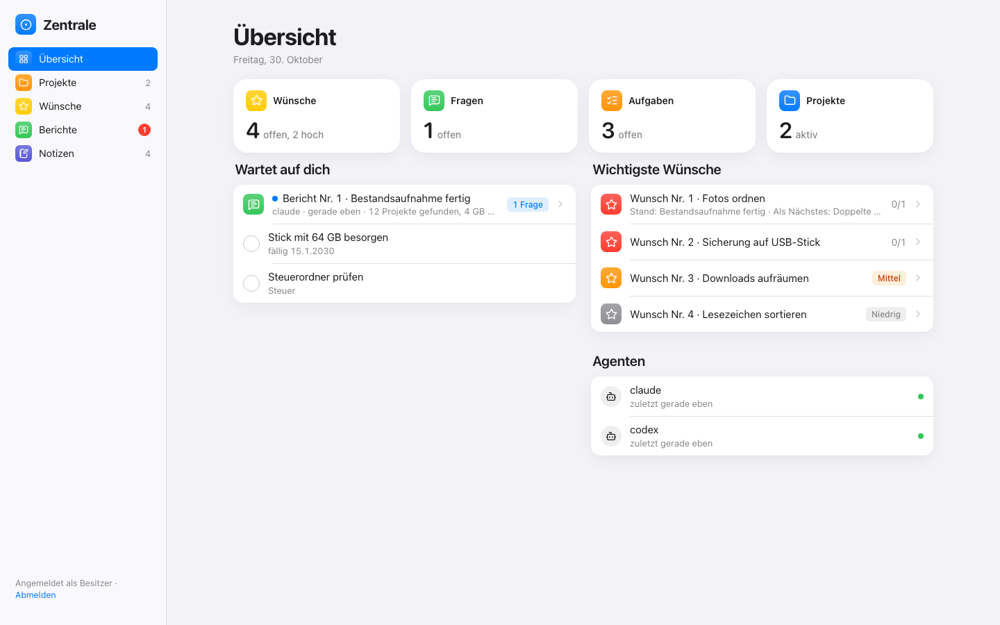

# Zentrale Starter

**Deutsch:** [README.md](README.md)

A small **hub** ("Zentrale") for your computer, plus a guide that lets your AI agent (Codex or Claude Code, for example in
T3 Code) tidy up your system: safely, in small steps. The only things deleted are those that regenerate on their own (caches,
old Python environments, `node_modules`, temp files). Everything else goes to a trash folder.

**Language:** The interface and the agent instructions (`AGENTS.md`, `REGELN.md`, `docs/`) are in German for now. Only this
README, `CONTRIBUTING.en.md` and `SECURITY.md` are available in English.



## What's inside

| Part | What it does |
|---|---|
| **Hub** | A web page on your own computer: overview, agents (who is working on what, what is finished), trash, projects with tasks, wishes with priority and notes, reports with tap-to-answer questions, notes as Markdown files. Light and dark mode. Python only, no other packages. |
| **Calendar, email, stock** | Your own appointments without an account, optionally plus iCloud or another CalDAV calendar. Mailboxes read only (iCloud, Gmail, IMAP), agents read them only if you switch it on. Goods and materials with stock levels, shopping list and bookings, also as a sentence ("25x Schrauben M4 dazu"). |
| **Homelab** | Old laptops, computers and a server: each device reports CPU, memory, disks, battery and services through a small reporter (Windows, Mac, Linux). Pages for devices, services, network and storage, with warnings. Your agent sets it up with you following `docs/HOMELAB.md`, including server, Tailscale and nightly backup. |
| **Agents** | Each agent has its own key and uses `zentrale_client.py` to record what it is doing and what it wants to ask you. |
| **Tidying up** | Tools in `aufraeumen/`: inventory (read only), backup to a USB drive with verification, moves only within the same disk with a log, undo for every step, trash instead of deleting. Plus a cleanup run for junk that regenerates (uv, pip, npm, old `.venv` and `node_modules`, temp files). |
| **Guide** | `AGENTS.md` (Codex) and `CLAUDE.md` (Claude) walk the agent through phases: backup, inventory, plan, tidying up, filling the hub. Each phase ends with your yes. |
| **Rules** | `REGELN.md`: how the agents should work. Your own rules go into `REGELN.lokal.md`, which survives every update and takes priority. |

## Quick start (Windows)

You need Python 3.9 or newer (python.org, tick "Add python.exe to PATH" during installation).

```powershell
cd $HOME\Projekte
git clone <address-of-this-repo> zentrale-starter     # or download the ZIP and unpack it here
cd zentrale-starter
py start.py
```

1. The first start shows **your key**. Put it in your password manager. It is shown only once.
2. Open http://127.0.0.1:8090 and enter the key.
3. Create keys for your agents (in a second window):
   ```powershell
   py start.py agent-neu claude
   py start.py agent-neu codex
   ```
   They end up in `%USERPROFILE%\.config\zentrale-starter\`. The agents use them with `--agent claude` or `--agent codex`.
4. Open the folder in T3 Code and tell your agent: **"Read AGENTS.md and start with phase 0."**
   In phase 0 it runs `py regeln_verteilen.py`, which writes `REGELN.md` into the instructions of Claude Code and Codex. Your
   rules then apply in every project: the agents say openly when an approach is wrong, and they look for existing open source
   before building something new.

**Update:** Tell your agent "Update holen" (get the update). It runs `py einrichten.py update`, which fetches the new version,
distributes the rules, restarts and checks.

**Already have another hub?** Tell your agent: **"Set up the hub following docs/EINRICHTEN.md."** It stops the old one, leaves
it untouched and asks you, item by item, what you want to bring over.

Start after login: `docs/AUTOSTART.md`. **Mac and Linux:** `python3` instead of `py`, otherwise the same.

## Security

- The hub listens only on `127.0.0.1`, so only your own computer can reach it. With `--heimnetz` (for the homelab) it also
  accepts devices over Tailscale (encrypted). It rejects the normal home network, other networks and the internet, and it gives
  out no data without a key. The normal home network works only with the explicit switch `--lan-unverschluesselt`, because keys
  could be read there.
- Devices have their own keys, which can only report.
- Keys are stored only as checksums. `daten/` (your entries) and the cleanup log are in `.gitignore`.
- The tidying tools move things to a trash folder on the same disk and log every step. Only the cleanup run
  (`aufraeumen/putzen.py`) deletes for good, and only what regenerates on its own (`docs/PUTZEN.md`): first as a dry run, then
  after your yes.

## Contributing

Anyone can contribute through pull requests: `CONTRIBUTING.en.md`. Please report security issues privately: `SECURITY.md`.

## License

**Apache License 2.0**, see `LICENSE`. © 2026 **Hadi Yousef** ([github.com/hadi-yousef](https://github.com/hadi-yousef)).

You may use, change and share the starter freely, including in your own projects. The condition: include the `NOTICE` file and
credit **Hadi Yousef** as the author where such notices usually go (README, about page, footer of the interface). Versions up
to and including commit `562a008` were under MIT.

The icons are from [Lucide](https://lucide.dev) (ISC license, see `zentrale/vendor/lucide-icons/LICENSE`).
