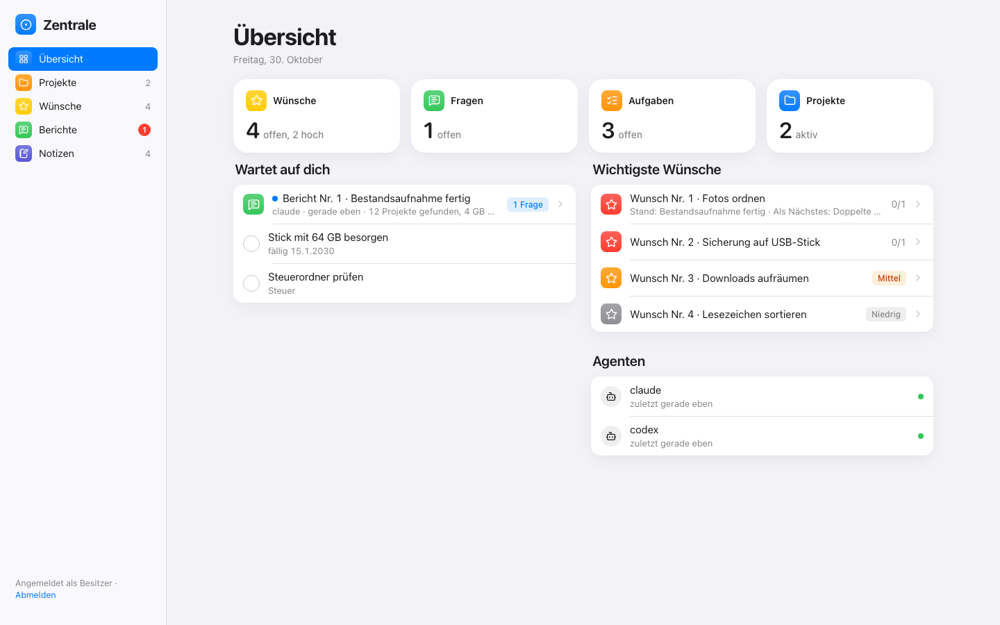

# Zentrale Starter

Eine kleine **Zentrale** für einen Rechner, und eine Anleitung, mit der dein KI-Agent (Codex oder Claude Code, z. B. in
T3 Code) bei dir aufräumt: sicher, in kleinen Schritten, ohne etwas zu löschen.



## Was drin ist

| Teil | Was es tut |
|---|---|
| **Zentrale** | Webseite nur auf deinem Rechner: Übersicht, Agenten (wer gerade woran arbeitet, was fertig ist), Projekte mit Aufgaben, Wünsche mit Priorität und Notizen, Berichte mit Fragen zum Antippen, Notizen als Markdown-Dateien. Hell und dunkel, auf Deutsch. Nur Python, keine weiteren Pakete. |
| **Agenten** | Jeder Agent hat einen eigenen Schlüssel und trägt über `zentrale_client.py` ein, was er tut und was er fragen will. |
| **Aufräumen** | Werkzeuge in `aufraeumen\`: Bestandsaufnahme (nur lesen), Sichern auf Stick mit Prüfung, Verschieben nur auf derselben Platte mit Protokoll, Rückgängig für jeden Schritt, Papierkorb statt Löschen. |
| **Anleitung** | `AGENTS.md` (Codex) und `CLAUDE.md` (Claude) führen den Agenten in Phasen durch: Sichern, Bestandsaufnahme, Plan, Aufräumen, Zentrale füllen. Jede Phase endet mit deinem Ja. |
| **Regeln** | `REGELN.md`: wie die Agenten arbeiten sollen. Eine Vorlage, die du anpasst. |

## Schnellstart (Windows)

Du brauchst Python 3.9 oder neuer (python.org, beim Installieren „Add python.exe to PATH“ anhaken).

```powershell
cd $HOME\Projekte
git clone <adresse-dieses-repos> zentrale-starter     # oder ZIP herunterladen und hierher entpacken
cd zentrale-starter
py start.py
```

1. Beim ersten Start erscheint **dein Schlüssel**. Leg ihn in deinen Passwort-Manager. Er wird nur einmal angezeigt.
2. Öffne http://127.0.0.1:8090 und gib den Schlüssel ein.
3. Schlüssel für deine Agenten anlegen (in einem zweiten Fenster):
   ```powershell
   py start.py agent-neu claude
   py start.py agent-neu codex
   ```
   Sie landen in `%USERPROFILE%\.config\zentrale-starter\`. Die Agenten nutzen sie mit `--agent claude` bzw. `--agent codex`.
4. Öffne den Ordner in T3 Code und sag deinem Agenten: **„Lies AGENTS.md und fang mit Phase 0 an.“**

Autostart nach der Anmeldung: `docs\AUTOSTART.md`. **Mac und Linux:** `python3` statt `py`, sonst gleich.

## Sicherheit

- Die Zentrale hört nur auf `127.0.0.1`, also nur auf deinen Rechner.
- Schlüssel werden nur als Prüfsumme gespeichert. `daten\` (deine Einträge) und das Aufräum-Protokoll stehen in `.gitignore`.
- Die Aufräum-Werkzeuge löschen nie. Sie verschieben auf derselben Platte und schreiben jeden Schritt ins Protokoll.

## Lizenz

MIT, siehe `LICENSE`. Die Symbole sind von [Lucide](https://lucide.dev) (ISC-Lizenz, siehe `zentrale\vendor\lucide-icons\LICENSE`).
