# Referenzbilder: so sieht die Zentrale aus

Für Agenten. **So muss die Zentrale aussehen**, wenn sie richtig läuft (Fassung 2026-11-02). Die Bilder sind mit
Beispieldaten gemacht. Sieht die Zentrale des Besitzers anders aus, fehlt links „Agenten“ oder „Papierkorb“, oder steht
unten links eine andere Fassung, dann arbeitest du an einer **alten oder falschen Zentrale**. Dann nicht weiterbauen,
sondern `AGENTS.md`, Abschnitt „Nur eine Zentrale“, befolgen.

Die Oberfläche wird nicht nachgebaut und nicht umgestaltet. Sie kommt fertig aus diesem Repo (`zentrale\index.src.html`).
Größere Änderungen nur nach Entwurf als Bild und OK des Besitzers (`REGELN.md`, „Oberflächen“).

| Bild | Seite | Worauf achten |
|---|---|---|
| 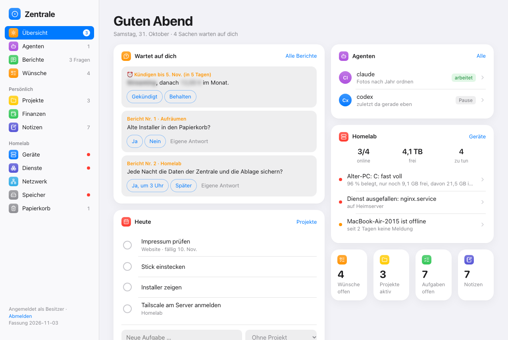 | **Übersicht** | Oben „Guten Tag“ mit Datum und wie viel auf dich wartet. Links „Wartet auf dich“ (je Bericht die aktuelle Frage mit Vorschlägen zum Antippen) und „Heute“ (deine Aufgaben zum Abhaken, unten neu eintragen). Rechts die Agenten, die Kachel Homelab (Geräte online, freier Platz, was zu tun ist) und vier Zahlen. Unten links „Fassung …“, dieselbe wie `FASSUNG` in `zentrale/hub.py`. |
| 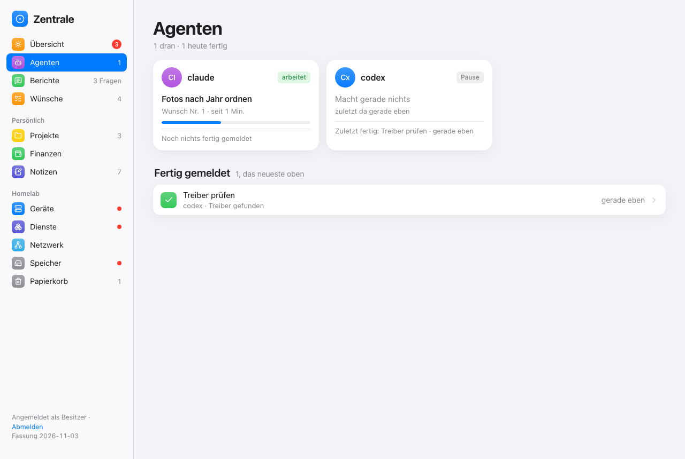 | **Agenten** | Eine Karte je Agent mit Arbeit, Wunsch-Nummer und Balken. Darunter „Fertig gemeldet“. |
| 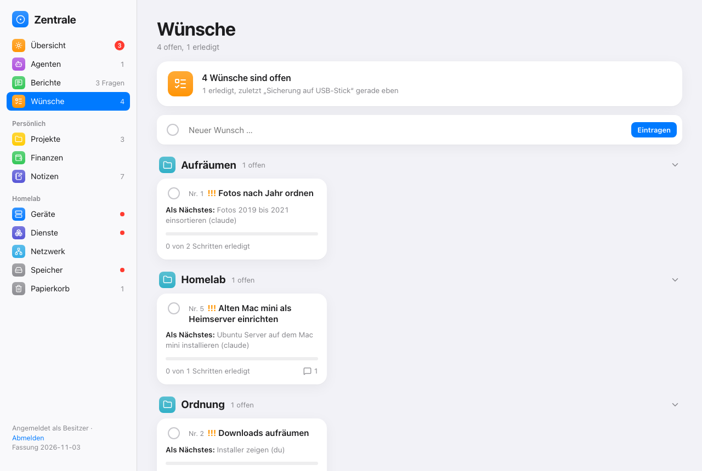 | **Wünsche** | Oben die Zahl, darunter „Neuer Wunsch …“. Je Gruppe ein Abschnitt (zuklappbar) mit Karten: Nr., Priorität als !!!/!!/!, Text oder „Als Nächstes“ mit Balken, die letzte Notiz grau. Unten das Erledigte. |
| 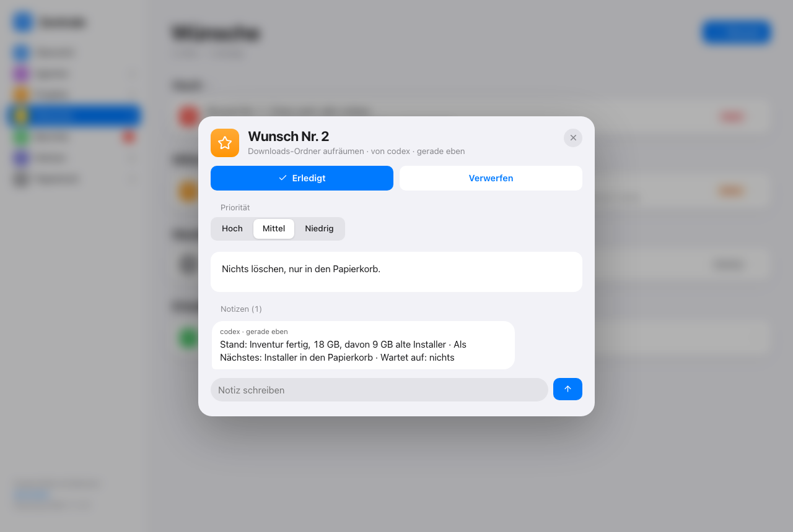 | Wunsch geöffnet | Erledigt, Verwerfen, Titel ändern; Gruppe, Priorität, Schritte mit Balken und „Schritt hinzufügen“, Notizen, Notiz schreiben. |
| 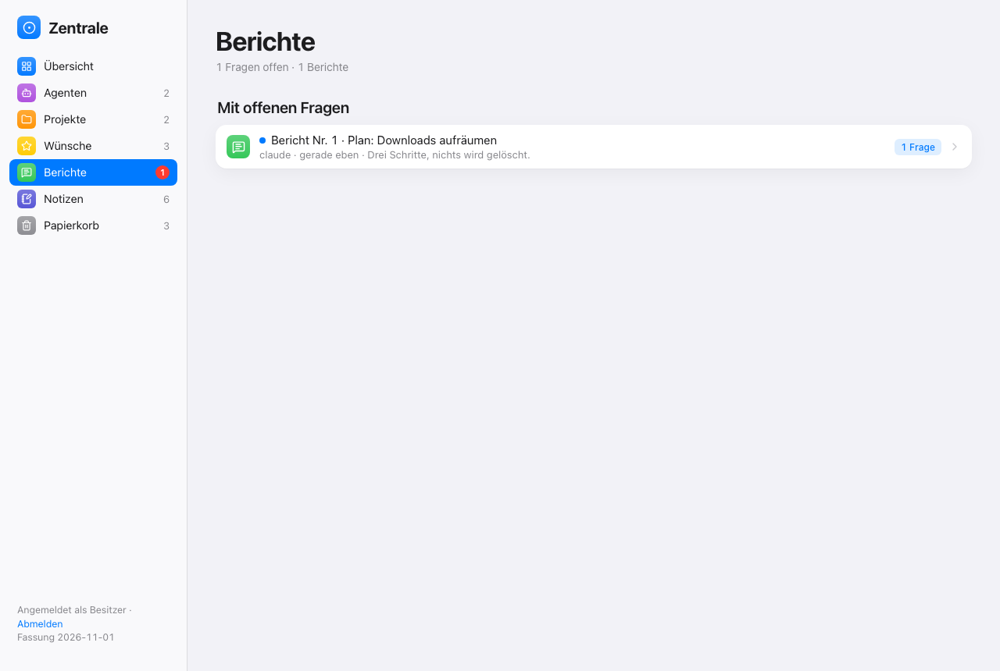 | **Berichte** | Links die Liste („Wartet auf dich“ oben, Nummer, Agent · Projekt, offene Fragen), rechts der Verlauf: Karte mit Kurzfassung und „Ganzen Bericht lesen“, dann **eine Frage nach der anderen** mit Vorschlägen zum Antippen, „noch N Fragen danach“. |
| 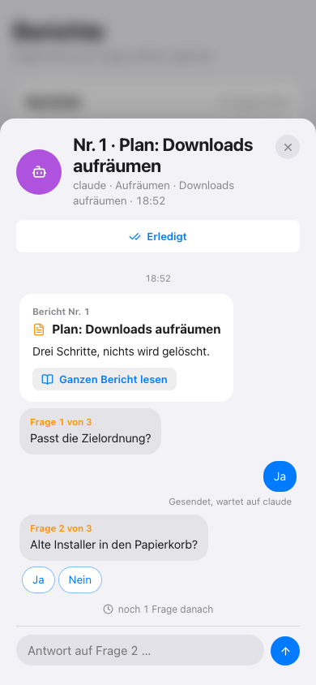 | Bericht am Handy | Öffnet als Blatt, gleiche Reihenfolge, unten das Antwortfeld. |
| 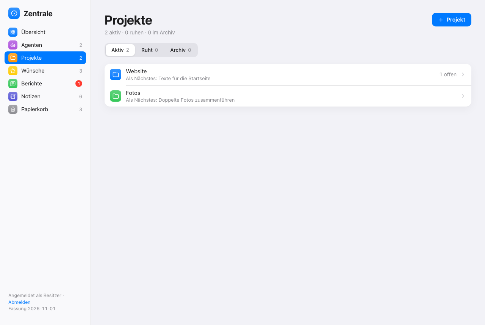 | **Projekte** | Aktive Projekte als Karten (Symbol, Gerät, „Als Nächstes“, Balken, offene Aufgaben, % erledigt). Darunter Aufgaben ohne Projekt, Ruht, Archiv und „Neues Projekt“. |
| 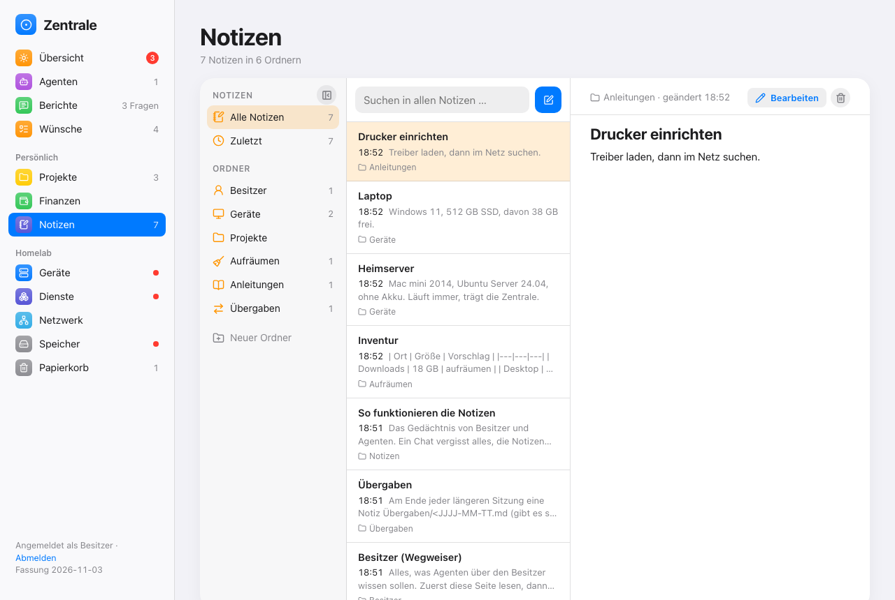 | **Notizen** | Drei Spalten: links „Alle Notizen“, „Zuletzt“ und die festen Ordner (Besitzer, Geräte, Projekte, Aufräumen, Anleitungen, Übergaben), in der Mitte die Liste mit Suche und Knopf für neue Notiz, rechts die Notiz mit „Bearbeiten“ und Papierkorb. Am Handy nur die Liste, die Notiz öffnet als Blatt. |
| 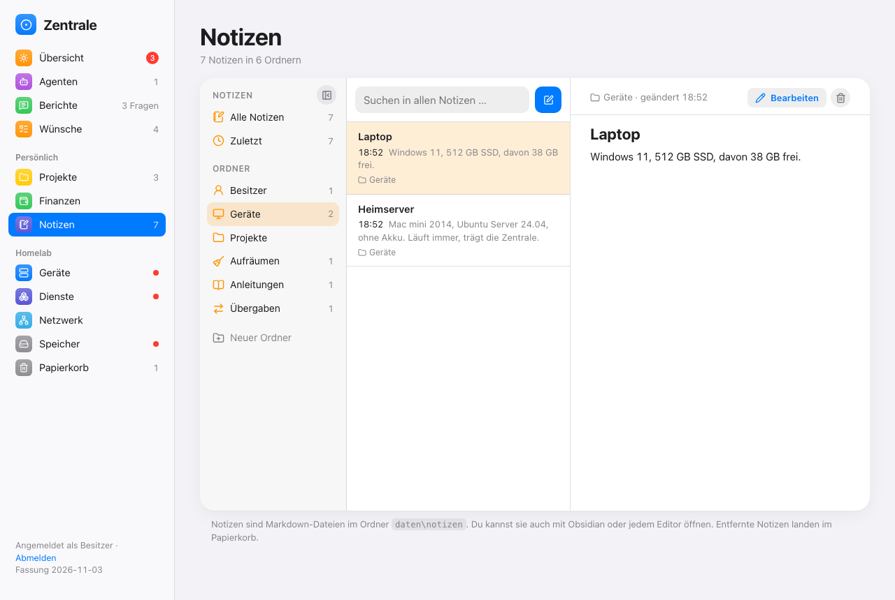 | Ordner gewählt | Die Liste zeigt nur diesen Ordner, links ist er markiert. |
| 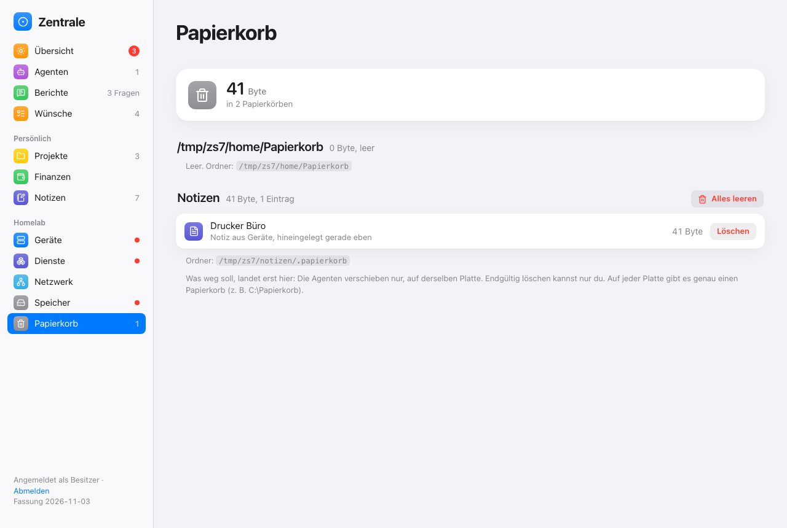 | **Papierkorb** | Oben die Summe. Je Papierkorb (C:\Papierkorb, Notizen) ein Abschnitt mit „Alles leeren“, in jeder Zeile „Löschen“, unten der Windows-Papierkorb mit „Leeren“. Löschen kann nur der Besitzer. |
| 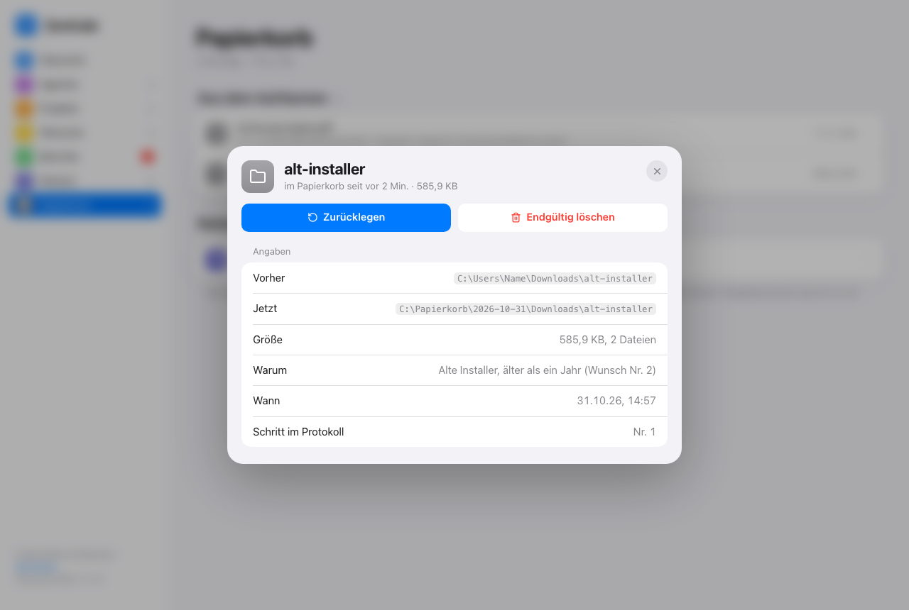 | Name angetippt | Herkunft und Größe, „Zurücklegen“ und „Endgültig löschen“. |
| 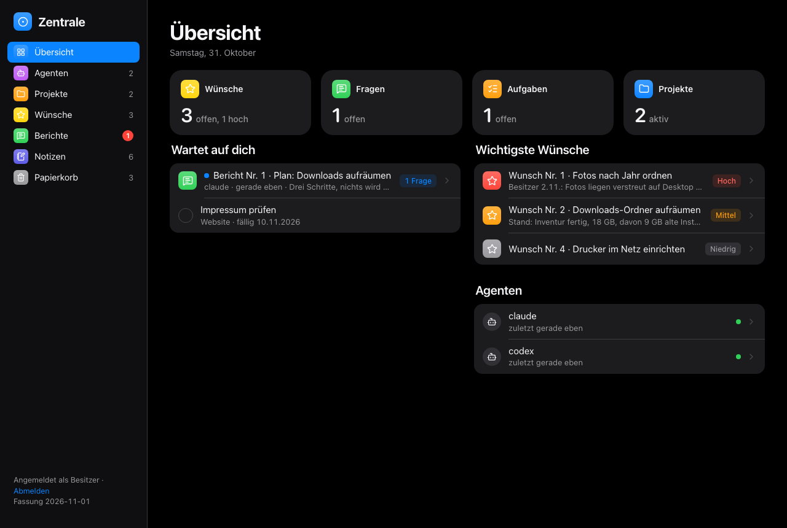 | dunkel | Folgt der Einstellung von Windows. |
| 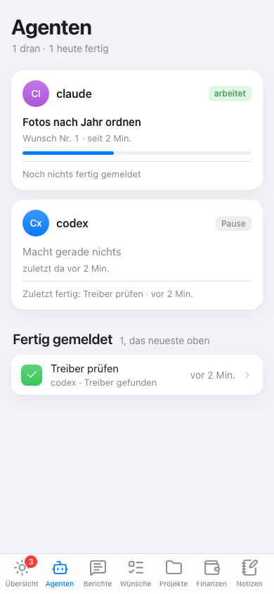 | Handy | Leiste unten statt links, bei vielen Seiten zum Wischen. |
| 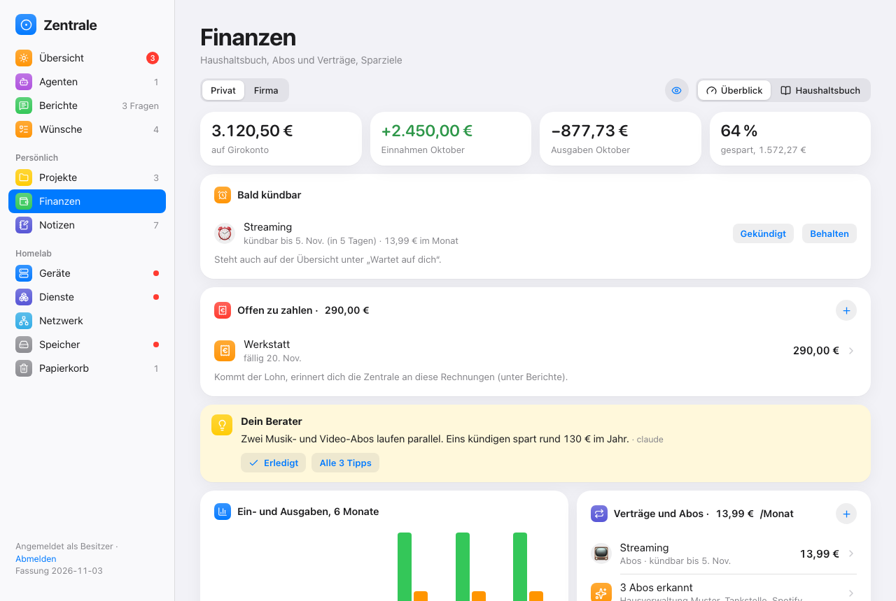 | **Finanzen** | Privat/Firma, Auge (Beträge sind verdeckt, bis man es antippt), Überblick/Haushaltsbuch. Vier Zahlen, Bald kündbar, Offen zu zahlen, Berater, Ein- und Ausgaben, Verträge und Abos, Sparziele. |
| 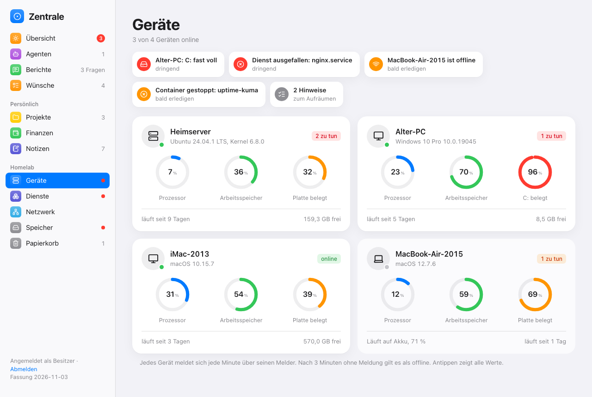 | **Homelab → Geräte** | Oben die Warnungen als Pillen (rot dringend, orange bald, grau Hinweise). Je Gerät eine Karte mit grünem bzw. grauem Punkt (online/offline), Ringen für Prozessor, Arbeitsspeicher und Platte, unten Akku und Laufzeit. Offline-Geräte blass. |
| 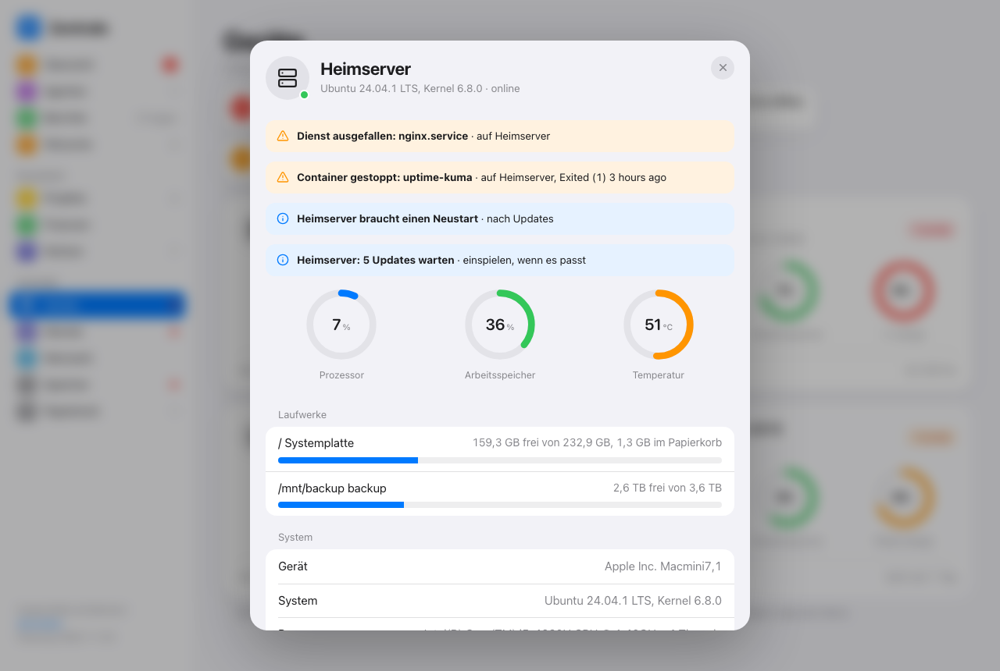 | Gerät angetippt | Warnungen, Ringe (auch Temperatur und Akku), Laufwerke mit Balken und Papierkorb, Akku, System, Netzwerk, Dienste. „Vergessen“ nur bei offline. |
| 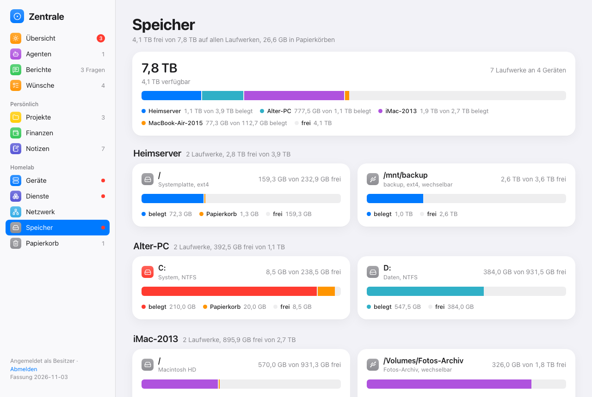 | **Homelab → Speicher** | Oben alle Laufwerke zusammen, je Gerät eine Farbe. Darunter je Gerät die Laufwerke mit belegt, Papierkorb (orange) und frei. Fast volle in Rot. |

Die Leiste hat oben Übersicht, Agenten, Berichte, Wünsche, unter „Persönlich“ Projekte, Finanzen, Notizen und unter
„Homelab“ Geräte, Dienste (nur wenn ein Linux-Gerät meldet), Netzwerk, Speicher, Papierkorb.
